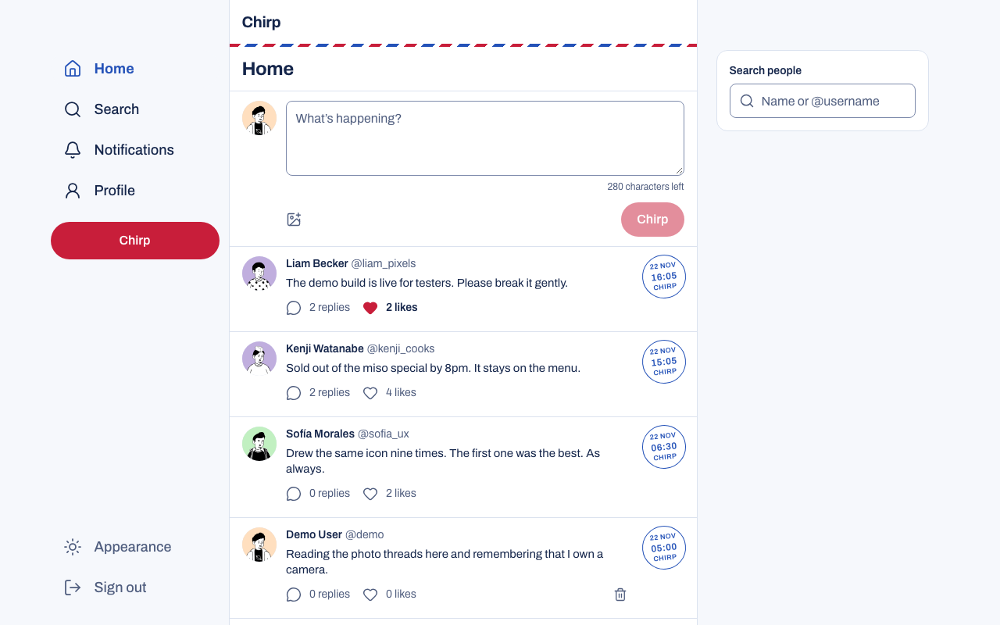
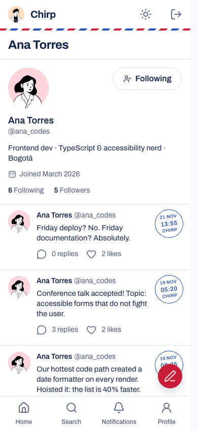

# Chirp

A Twitter/X clone: post short chirps, follow people, like and reply, and read a chronological timeline. Built as a production-minded monorepo with a Fastify + PostgreSQL API, a React SPA and shared Zod contracts, fully tested and runnable with one command.

<p>
  
  
</p>

**Features:** sign up, sign in and out · protected routes · profiles with bio and avatar · chirps up to 280 characters (with an optional image) · home timeline with infinite scroll · follow and unfollow · likes with counts · followers and following lists · people search · reply threads · notifications · light and dark themes · mobile-first layout.

## Quick start (Docker)

Needs Docker with Compose v2 (checked with Docker 20.10.8 and Compose 2.0.0) and free ports 8080, 5433, 9000 and 9001.

```bash
docker compose up --build
```

Open **http://localhost:8080** and sign in with **`demo@chirp.dev` / `Password123!`** (or press *Use the demo account*). The first start migrates the database and loads the demo data; restarts keep your data.

## Run it locally

**Prerequisites:** Node **22.23.5** (`.nvmrc`; npm 10.9 comes with it) and Docker. Ports 3000, 5173, 5433, 9000 and 9001 must be free.

```bash
nvm use                  # Node 22.23.5
cp .env.example .env     # working local defaults, nothing to edit
npm ci
npm run services:up      # PostgreSQL (5433) and S3-compatible storage (9000)
npm run db:migrate
npm run db:seed          # demo users, chirps, follows, likes, replies, notifications
npm run dev              # API on :3000, web app on http://localhost:5173
```

### Demo accounts

Every account uses the password **`Password123!`**. Emails are `<username>@chirp.dev`.

| Username | Who | Username | Who |
|---|---|---|---|
| `demo` | Demo User (start here) | `dave_runs` | David Okafor, marathon coach |
| `ana_codes` | Ana Torres, frontend dev | `amara_climate` | Amara Nwosu, climate researcher |
| `marco_lens` | Marco Rossi, photographer | `liam_pixels` | Liam Becker, indie game dev |
| `lucia_data` | Lucía Fernández, data scientist | `priya_ships` | Priya Raman, product manager |
| `kenji_cooks` | Kenji Watanabe, ramen chef | `mateo_beats` | Mateo Silva, music producer |
| `sofia_ux` | Sofía Morales, UX designer | `chloe_wanders` | Chloé Martin, travel writer |

## Tests

| Command | What it runs |
|---|---|
| `npm run verify` | lint, format check, typecheck and all unit and integration tests with coverage. Coverage must stay at or above 85% lines (80% branches) for the API and 70% for the web app. |
| `npm test` | tests only (shared schemas, API against a real PostgreSQL `chirp_test`, web with Testing Library + MSW) |
| `npm run test:e2e` | Playwright in Chromium against the real stack: sign up and in, compose, follow, reply. Run `npx playwright install chromium` once first. |

Tests need `npm run services:up`. Run `npm test` and `npm run test:e2e` one at a time: both use the `chirp_test` database. CI runs `verify` and the end-to-end suite on every push and pull request.

## Configuration

`.env.example` documents every variable with a working local value. The ones that matter most:

| Variable | Purpose |
|---|---|
| `DATABASE_URL` / `TEST_DATABASE_URL` | development and test databases (the test one must end in `_test`) |
| `S3_ENDPOINT`, `S3_PUBLIC_ENDPOINT`, `S3_ACCESS_KEY_ID`, `S3_SECRET_ACCESS_KEY` | object storage for images; required, no defaults |
| `WEB_ORIGINS` | browser origins allowed to make changes (CSRF defense) |
| `COOKIE_SECURE` | `true` behind HTTPS |
| `RATE_LIMIT_GLOBAL_MAX`, `RATE_LIMIT_AUTH_MAX` | requests per minute per IP, overall and on sign-in/sign-up |

The API validates its configuration at startup and exits with a clear message if something is missing.

## How it is built

```
apps/api        Fastify + Prisma + PostgreSQL. One folder per feature: routes (HTTP) and service (rules).
apps/web        React + Vite SPA. One folder per feature: api, query keys, hooks, components, pages.
packages/shared Zod schemas for every request and response, used by both sides.
```

Further reading: [architecture](docs/ARCHITECTURE.md) · [all decisions](docs/DECISIONS.md) · [plan and changelog](docs/PLAN.md) · [design system](DESIGN.md) · [product context](PRODUCT.md) · [UI audit](docs/audits/2026-11-23-c50-ui-audit.md).

### Key decisions

- **Sessions, not JWTs.** An opaque token in an httpOnly cookie, stored hashed in the database, so sign-out and expiry are immediate. ([ADR-09](docs/DECISIONS.md#adr-09--authentication-server-side-sessions-in-an-httponly-cookie))
- **One contract, two sides.** Zod schemas in `packages/shared` validate requests in the API and every response in the browser. ([ADR-02](docs/DECISIONS.md#adr-02--shared-contracts-as-an-internal-package))
- **Keyset pagination** on `(createdAt, id)`: no duplicates or gaps while new chirps arrive. ([ADR-11](docs/DECISIONS.md#adr-11--keyset-pagination-on-createdat-id))
- **Timeline computed on read** with an index instead of fan-out tables; simple and fast at this scale. ([ADR-12](docs/DECISIONS.md#adr-12--timeline-fan-out-on-read))
- **Counts are aggregated**, not stored, so they can never drift. ([ADR-13](docs/DECISIONS.md#adr-13--like-counts-are-aggregated-not-denormalized))
- **Images go straight to storage** with presigned URLs; the API never streams files. ([ADR-14](docs/DECISIONS.md#adr-14--media-s3-compatible-storage-with-presigned-uploads))
- **Single origin** everywhere (Vite proxy in development, nginx in Docker): no CORS, same-site cookies. ([ADR-17](docs/DECISIONS.md#adr-17--single-origin-in-every-environment))
- **Server data lives in TanStack Query only**; likes and follows update optimistically and roll back on failure. ([ADR-07](docs/DECISIONS.md#adr-07--state-tanstack-query-for-server-state-zustand-for-ui-state))
- **Tests hit a real database**, never a mocked ORM. ([ADR-19](docs/DECISIONS.md#adr-19--integration-tests-against-a-real-database))
- **The seed never deletes data it did not create**, and the Docker image seeds only when asked. ([ADR-23](docs/DECISIONS.md#adr-23--the-seed-never-resets-data-it-did-not-create))

## Trade-offs and known limitations

- **Out of scope:** real-time updates (notifications poll every 30 s), retweets and quotes, direct messages, email verification, password reset, OAuth.
- **Timeline on read** would need fan-out on write (or a cache) at much larger scale.
- **Rate limits live in memory** per API process; several instances would need a shared store such as Redis.
- **Some images stay in storage:** uploads never posted, and images of replies removed together with their thread. A bucket lifecycle rule or a cleanup job would collect them.
- **UI:** on a phone with text at 200% the chirp action row overflows (WCAG reflow and resize checks pass); signed-out pages log a 401 from the session check. Details in the [UI audit](docs/audits/2026-11-23-c50-ui-audit.md).

## How AI was used

Chirp was built with [Claude Code](https://claude.com/claude-code), directed step by step ([ADR-22](docs/DECISIONS.md#adr-22--ai-assisted-development-workflow)):

- **Plan before code.** The [plan](docs/PLAN.md), [architecture](docs/ARCHITECTURE.md) and [decisions](docs/DECISIONS.md) were written and reviewed first. The plan splits the work into small numbered commits.
- **Rules as context.** [`CLAUDE.md`](CLAUDE.md) holds the patterns, the testing rules and the definition of done, so every session works the same way.
- **One commit at a time, reviewed by a human.** For each commit the agent explained the goal and the decisions, waited for approval, implemented it with its tests, ran `npm run verify` and stopped. I reviewed every diff and made every commit myself; the agent never commits.
- **Vetted skills.** Agent skills for Fastify, Prisma, React, design and Playwright were read in full before installing and are pinned in `skills-lock.json`.
- **Decisions stayed human.** Product changes came from using the app: reply threads were added as a new phase, the reply action was changed to open the conversation, and a safeguard was added so the seed can never wipe real data. Every deviation from the plan is recorded in its [changelog](docs/PLAN.md#9-plan-changelog).

## Troubleshooting

| Problem | Fix |
|---|---|
| A port is already in use | stop what uses it, or change `POSTGRES_PORT`, `STORAGE_PORT` or `WEB_PORT` in `.env` |
| `db:seed` cannot upload avatars | storage is not running: `npm run services:up` |
| `db:seed` refuses to reset | the database holds accounts the seed did not create. To replace them anyway: `SEED_CONFIRM_RESET=chirp npm run db:seed` |
| Errors on install or start | use Node 22.23.5 (`nvm use`); several dependencies need 22.22 or later |
